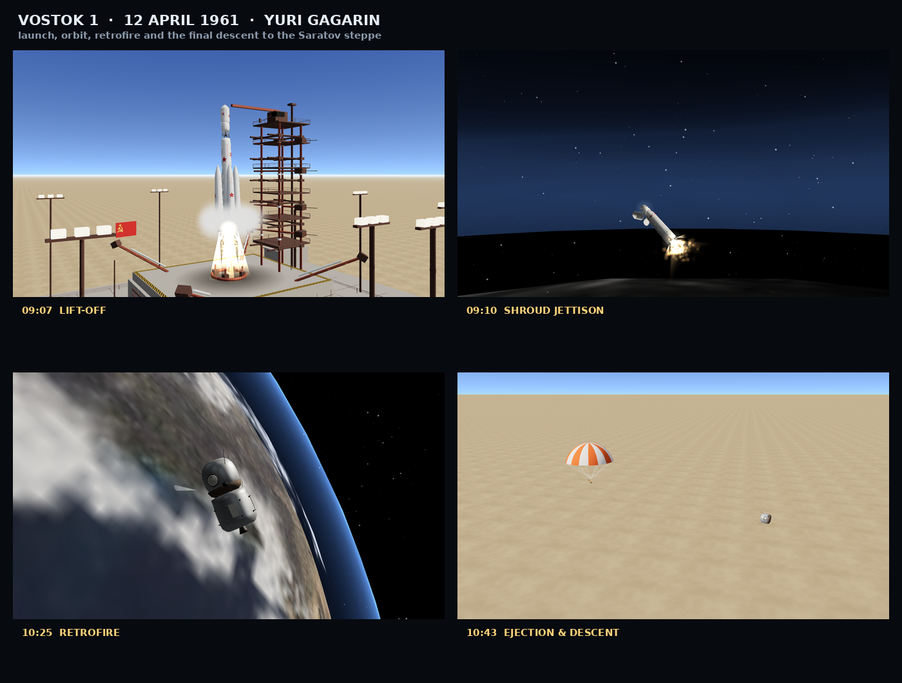
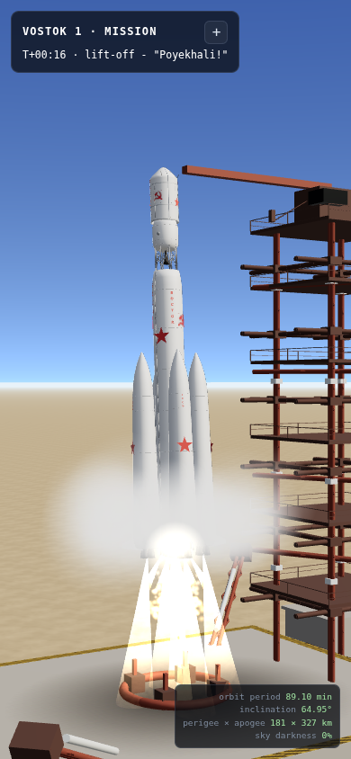
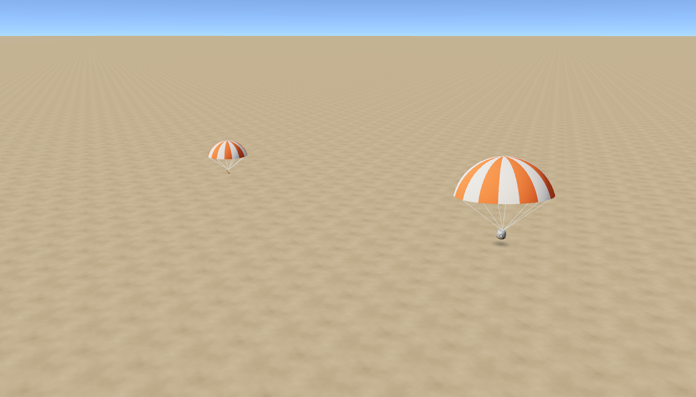
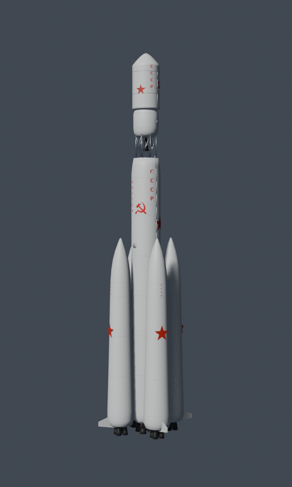

# Vostok 1 — Launch, Orbit & Landing

An interactive WebGL visualization of **Yuri Gagarin's Vostok 1 mission**
(12 April 1961), rendered as one continuous shot: the Baikonur launch pad,
ignition and lift-off, the gravity turn with the sky darkening to space,
the two-petal shroud, Korolev-cross strap-on separation, core staging, the
Block-E burn, orbital insertion into the real 181 × 327 km orbit, then
retrofire, the delayed instrument-module separation, re-entry, the capsule's
parachute, Gagarin's own ejection and descent, and touchdown on the Saratov
steppe.



## Running

It is a static site — no build step. Serve the directory with any web server:

```bash
python3 -m http.server 8000
# then open http://localhost:8000/launch.html
```

- `launch.html` — the full mission animation
- `index.html` — a model viewer for the Vostok 8K72K stack

## Controls

| Control | Action |
|---|---|
| `Space` / play button | play / pause |
| timeline slider | seek to any mission moment |
| `0.25×–2×` | playback rate (mission runs at ~67× real time) |
| `R` / restart | back to T−10 s |
| `C` / camera buttons | toggle auto camera / free look |
| `I` / chevron | collapse or expand the mission panel |
| `?t=0.62` | deep-link a normalized mission time (e.g. `&play=0` to freeze) |

Hover the timeline ticks for the published Moscow Time of each event. The
panel shows both the mission clock and the wall clock (MSK and UTC). On
narrow/portrait screens the panel starts collapsed to a compact clock and
phase bar, so the flight fills the screen; tap the chevron to open it.



## The flight profile

The sequence is keyed to real event times, not hand-placed animations. The
event times below are the post-flight record used by RussianSpaceWeb, with
the launch at **09:06:59.7 MSK = 06:06:59.7 UTC**:

| Moscow time | T+ | Event |
|---|---|---|
| 09:06:59.7 | 0 | lift-off; “Poyekhali!” |
| 09:09:00 | 1 min 59 s | four strap-ons burn out and separate (Korolev cross) |
| 09:09:34 | 2 min 34 s | payload shroud splits into two petals |
| 09:11:56 | 4 min 56 s | Block-E ignition while Block A is still shutting down |
| 09:11:59 | 4 min 59 s | Block A core separation |
| 09:18:16 | 11 min 16 s | Block-E cutoff; 181 × 327 km orbit |
| 09:18:28 | 11 min 28 s | spacecraft separation from Block E |
| 10:25:00 | 78 min | TDU-1 retrofire (nominal 40 s, ~39 s actual) |
| 10:35:00 | 88 min | instrument module (PA) finally separates |
| 10:36:00 | 89 min | entry interface, ~120 km |
| 10:39:40 | 92 min 40 s | peak deceleration, ~8.5 g |
| 10:42:00 | 95 min | Gagarin ejects at 7 km |
| 10:44:00 | 97 min | descent module's main canopy at 2.5 km |
| 10:48:00 | 101 min | descent module lands |
| 10:53:00 | 106 min | Gagarin lands, ~1.5 km from the capsule |

The famous **108-minute** duration was the official record claim. The
post-flight report and later histories (RussianSpaceWeb, Siddiqi) give
**106 minutes**; the app uses the latter and labels the older figure in the
notes above. The orbit period is the 89.1 min in the FAI/NASA record.

The **delayed PA separation** is not a dramatisation: the TDU-1's leaking
valve made the engine shut down early, so the nominal separation command was
never issued and the spacecraft tumbled until the instrument module was
released about ten minutes later, over the Mediterranean. The app models the
tumble and late separation.

## What is simulated

- **Vehicle dynamics** — gravity turn, hot-staged Block-E ignition, the
  Korolev cross, a two-petal shroud jettison, core staging, retrograde TDU-1
  burn with the capsule tail-first, heat-shield-first re-entry, and Gagarin's
  ejection and personal canopy.
- **Telemetry** — live altitude, velocity, g-load, mass (with propellant
  burn and stage drops), range to pad, orbit period/inclination/perigee and
  apogee, and sky darkness. Values between the published anchors are
  interpolations for display.
- **Effects** — shader plumes with animated soft edges and mach diamonds,
  per-nozzle booster/vernier jets, a particle sheath for turbulent flame,
  staging flashes, re-entry plasma and trail, pad smoke, and steppe dust.
- **Environment** — day-to-space sky transition keyed to real altitude, NASA
  Blue Marble Earth with clouds, night lights and an atmosphere limb, and the
  correct 64.95° orbit inclination over Baikonur's latitude.
- **Launch complex** — a Site 1/5-style pad: raised flame-trench block with a
  dark trench mouth and deflector, a 46 m lattice service tower with working
  platforms, crane, swing arms and hold-down hydraulics, propellant spheres,
  a water tower, control bunker, rail transporter, floodlight masts, apron,
  access road, fence, pad markings and a Soviet flag.
- **Models** — the R-7/Vostok 8K72K stack (GLB), a procedurally rebuilt 3KA
  spacecraft, and a MakeHuman cosmonaut in an SK-1-style suit who ejects at
  7 km and lands under his own parachute beside the capsule. Both canopies
  attach at their real hardpoints, and contact shadows ground the final pose.

### The descent



The descent module's canopy attaches at the top of the SA, and Gagarin's
personal canopy attaches at his harness. The SA sits heat-shield-down on the
steppe and Gagarin's feet reach the ground; soft contact shadows keep both
from reading as if they hover.

### The 8K72K model



The stack is generated from `tools/build_vostok.py` at true scale (metres):

- 38.36 m overall, 10.3 m span over the fins;
- Block A core 28.0 m × 2.95 m with an RD-108 (four chambers + four
  verniers) and the open interstage truss;
- four strap-ons 19.8 m × 2.68 m with RD-107 engines, verniers, fins,
  raceways and tank seams;
- Block E third stage with the RD-0109 nozzle visible through the truss;
- a two-petal, 2.7 m payload shroud that clears the whole spacecraft;
- the 3KA spacecraft as a separate **SA** (2.30 m sphere, heat shield,
  hatch, Vzor window, portholes, antennas) and **PA** (2.25 m instrument
  module with TDU-1, 16 cold-gas thrusters, tanks and radiator shutters),
  giving the correct 4.55 m / 4.73 t spacecraft;
- painted markings around the whole stack: vertical **CCCP** on the core,
  shroud and strap-ons, **ВОСТОК** on the core, large red stars on the core,
  shroud and boosters, and the hammer-and-sickle emblem on both the core and
  the shroud. The letters are geometry; the stars and emblem are small alpha
  decals wrapped onto curved sheets (`tools/star_source.png`,
  `tools/emblem_source.png`) so they follow the tank instead of standing off
  it. There is no 4K atlas.

The viewer's staging slider separates the strap-ons, fins, shroud petals,
core/truss, Block E and spacecraft; the capsule and PA are preserved as a
group so the model remains inspectable.

## Project layout

```
index.html / main.js      model viewer
launch.html / launch.js   mission animation (all simulation code)
assets/                   GLB models, Earth textures, Blender source
vendor/                   three.js + addons (no npm required)
tools/                    Blender Python scripts that regenerate the models
preview.png               the 8K72K model
preview-mission.png       four key moments of the flight
```

## Rebuilding the models

The launch vehicle and 3KA are generated by Blender Python (developed with
Blender 5.2):

```bash
blender --background --factory-startup --python tools/build_vostok.py     # rocket + 3KA + GLB
blender --background --factory-startup --python tools/build_cosmonaut.py  # gagarin.glb
```

`tools/build_vostok.py` writes `assets/vostok-source.blend` and
`assets/vostok-1.glb`. The old 4K paint atlas has been retired: the livery
is geometry plus two small curved decals (star and hammer-and-sickle), so
the markings stay flush and crisp at any distance.

## Credits

- [three.js](https://threejs.org) (MIT) — rendering.
- NASA Blue Marble Earth imagery (public domain) — see
  `assets/textures/earth/SOURCES.md`.
- [MPFB — MakeHuman Plugin for Blender](http://www.makehumancommunity.org/) —
  cosmonaut base mesh.
- Flight profile and spacecraft data:
  [RussianSpaceWeb — Vostok 1](https://www.russianspaceweb.com/vostok1.html),
  [launch](https://www.russianspaceweb.com/vostok1_launch.html),
  [landing](https://www.russianspaceweb.com/vostok1_landing.html) and
  [the 8K72K](https://www.russianspaceweb.com/vostok_lv.html);
  [Vostok spacecraft](https://en.wikipedia.org/wiki/Vostok_%28spacecraft%29);
  [Vostok 1](https://en.wikipedia.org/wiki/Vostok_1);
  [Gunter's Space Page — Vostok-3K](https://space.skyrocket.de/doc_sdat/vostok-3k.htm).
- Livery reference: the full-scale 8K72K at VDNKh, Moscow
  ([Wikimedia Commons](https://commons.wikimedia.org/wiki/File:Vostok_8K72K_in_VDNKh_(1).jpg),
  CC BY-SA 4.0).
- Hammer-and-sickle source: public-domain SVG/PNG from Wikimedia Commons,
  kept as `tools/emblem_source.png`.
